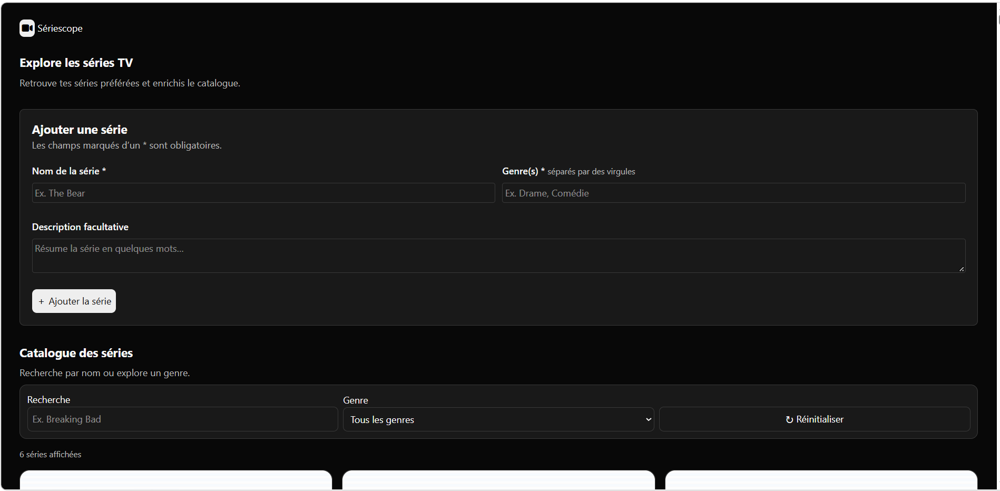
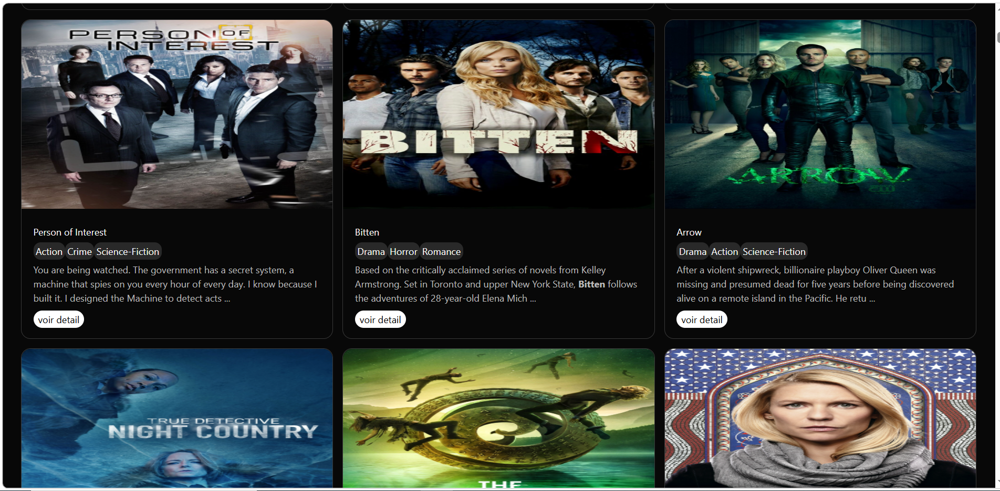

# 🎬 SérieScope — Catalogue de Séries et Documentaires

## 📌 Description du projet

SérieScope est une application web interactive et responsive développée pour une médiathèque souhaitant proposer à ses visiteurs un catalogue en ligne de séries et de documentaires.

L'application permet aux utilisateurs de consulter les séries disponibles, rechercher un titre, filtrer le catalogue par genre et découvrir les informations de chaque série.

Elle permet également à l'équipe de la médiathèque d'ajouter de nouvelles séries directement depuis l'interface, sans recharger la page.

Le catalogue initial est alimenté par l'API publique **TVmaze**, en utilisant `fetch()` et JavaScript Vanilla.

SérieScope est une Single Page Application (SPA) développée avec HTML5, Bootstrap ou Tailwind CSS et JavaScript Vanilla ES6+.

Les séries ajoutées sont conservées dans un tableau JavaScript jusqu'au rechargement de la page. La sauvegarde avec `localStorage` est proposée en bonus.

---

## 🎯 Objectifs du projet

- Développer une application web responsive.
- Concevoir une interface utilisateur intuitive.
- Utiliser HTML5 et ses balises sémantiques.
- Intégrer une maquette réalisée avec Figma.
- Utiliser Bootstrap ou Tailwind CSS.
- Consommer une API REST avec `fetch()`.
- Manipuler les données JSON et les objets imbriqués.
- Exploiter les tableaux et objets JavaScript.
- Manipuler dynamiquement le DOM.
- Implémenter une recherche instantanée.
- Filtrer les séries selon leurs genres.
- Ajouter de nouvelles séries via un formulaire.
- Valider les champs et gérer les erreurs.
- Utiliser les événements avec `addEventListener()`.
- Organiser le travail avec Git, GitHub, GitFlow et Jira.

---

## ✨ Fonctionnalités

### 🎬 1. Catalogue des séries

Le catalogue affiche dynamiquement les séries récupérées depuis l'API TVmaze.

Au chargement de l'application, une requête GET est envoyée vers :

`https://api.tvmaze.com/shows?page=0`

Les 20 premières séries sont récupérées et stockées dans un tableau JavaScript.

Chaque série est présentée sous forme de carte contenant :

- Le titre de la série.
- L'affiche.
- La langue.
- Le statut de diffusion.
- Les genres.
- Une description.

Les genres sont affichés sous forme de badges.

Une image de remplacement est utilisée lorsqu'une affiche est absente.

Les informations manquantes sont remplacées par des valeurs par défaut.

### 🔍 2. Recherche par nom

L'application propose un champ de recherche intitulé « Rechercher une série ».

Fonctionnalités :

- Recherche instantanée à chaque saisie.
- Recherche par correspondance partielle.
- Recherche insensible à la casse.
- Actualisation dynamique du catalogue.
- Combinaison avec le filtre par genre.

**Exemple :**

Une recherche avec `breaking` permet de retrouver `Breaking Bad`.

### 🏷️ 3. Filtrage par genre

Un système de filtrage permet de parcourir le catalogue selon les genres disponibles.

Les options sont générées dynamiquement à partir des genres présents dans les données de l'API.

Une option « Tous les genres » permet de réinitialiser le filtre.

Fonctionnalités :

- Utilisation de `.filter()`.
- Utilisation de `.includes()`.
- Affichage des séries correspondant au genre sélectionné.
- Gestion des séries possédant plusieurs genres.
- Actualisation automatique du catalogue.
- Affichage d'un message lorsqu'aucune série ne correspond.

### ➕ 4. Ajout d'une série

L'application propose un formulaire permettant d'ajouter une nouvelle série.

Le formulaire contient trois champs obligatoires :

- **Titre :** nom de la série.
- **Langue :** langue de la série.
- **Genre :** genre sélectionné parmi les choix disponibles.

Validations :

- Vérification des champs obligatoires.
- Refus des titres vides ou composés uniquement d'espaces.
- Affichage des messages d'erreur près des champs concernés.

Après un ajout valide :

1. Création d'un objet compatible avec la structure des séries.
2. Enregistrement du genre dans le tableau `genres`.
3. Ajout de la série au tableau JavaScript.
4. Actualisation du catalogue sans rechargement.
5. Conservation du filtre actif.
6. Affichage d'un message de confirmation.
7. Réinitialisation du formulaire.

### 🔄 5. Mise à jour dynamique du catalogue

Une fonction d'affichage réutilisable permet d'actualiser les cartes après chaque action :

- Chargement initial.
- Recherche par titre.
- Changement de genre.
- Ajout d'une nouvelle série.
- Réinitialisation des filtres.

Un message « Aucune série à afficher » est présenté lorsque la liste est vide.

### ⚠️ 6. Gestion des erreurs

L'application prévoit plusieurs états :

- **Chargement :** message pendant la récupération des données.
- **Erreur :** message explicite en cas d'échec de la requête API.
- **Confirmation :** message après l'ajout d'une série.
- **État vide :** message lorsqu'aucun résultat ne correspond.

Les requêtes API sont gérées avec :

- `async/await`
- `try...catch`
- `response.ok`

### 💾 7. Sauvegarde locale — Bonus

Une sauvegarde avec `localStorage` peut être ajoutée pour conserver les séries ajoutées après le rechargement de la page.

Fonctionnalités :

- Enregistrement des séries ajoutées.
- Récupération des données sauvegardées.
- Réintégration des séries personnelles au catalogue.

### 📄 8. Fiche détaillée — Bonus

Chaque carte peut proposer un bouton « Voir les détails ».

Les informations supplémentaires comprennent :

- Note moyenne : `rating.average`.
- Jours de diffusion : `schedule.days`.
- Heure de diffusion : `schedule.time`.
- Nom de la chaîne : `network.name`.
- Pays de la chaîne : `network.country.name`.

Lorsqu'une information est absente, la mention « Non renseigné » est affichée.

---

## 🛠️ Technologies utilisées

| Technologie | Utilisation |
|---|---|
| HTML5 | Structure sémantique |
| Bootstrap / Tailwind CSS | Design et responsive |
| JavaScript Vanilla ES6+ | Logique et interactivité |
| Fetch API | Récupération des données |
| TVmaze API | Source des séries |
| JSON | Manipulation des données |
| DOM | Affichage dynamique |
| Async/Await | Requêtes asynchrones |
| Array Methods | Recherche et filtrage |
| LocalStorage | Sauvegarde locale (bonus) |
| Figma | Maquettes UI/UX |
| Git | Versionnement |
| GitHub | Hébergement du code |
| GitFlow | Gestion des branches |
| Jira | Gestion des tâches |
| VS Code | Environnement de développement |

---

## 📁 Structure du projet

```text
seriescope/
│
├── index.html
│
├── css/
│   └── style.css
│
├── js/
│   ├── script.js
│
├── assets/
│   ├── images/
│   │   └── image.png
│
├── screenshots/
│   ├──affichage.png
│   └── formulaire.png
│   └── jira.png
│
└── README.md
```

### Description des fichiers

- `index.html` : structure principale de l'application.
- `css/style.css` : styles personnalisés et responsive design.
- `js/script.js` : initialisation , récupération , recherche validation et l'affichage des series.
- `assets/` : images, icônes et ressources graphiques.
- `screenshots/` : captures d'écran du projet.
- `README.md` : documentation du projet.


---

## 🌐 API utilisée

### TVmaze API

SérieScope utilise l'API publique TVmaze pour récupérer les informations des séries télévisées.

**Endpoint utilisé :**

```http
GET https://api.tvmaze.com/shows?page=0
```


---


## 📱 Responsive Design

SérieScope adopte une approche Mobile First afin de garantir une expérience utilisateur optimale sur tous les appareils.

L'interface est adaptée aux :

- Smartphones.
- Tablettes.
- Ordinateurs de bureau.

### Breakpoints

| Appareil | Largeur | Présentation |
|---|---|---|
| Mobile | Moins de 768px | Une colonne |
| Tablette | À partir de 768px | Deux colonnes |
| Desktop | À partir de 1024px | Plusieurs colonnes |

Le responsive design concerne :

- La grille des cartes.
- Le formulaire d'ajout.
- La barre de recherche.
- Les filtres.
- La navigation.
- Les espacements et les tailles de texte.

L'application prévoit également une navigation au clavier et des messages de validation accessibles.

---

## 📊 Gestion du projet avec Jira

Le développement de SérieScope est organisé avec Jira afin de planifier les tâches et de suivre leur progression.

### Organisation Kanban

Le board Jira utilise quatre statuts :

- **À faire :** tâches à réaliser.
- **En cours :** tâches en développement.
- **En revue :** tâches en attente de vérification.
- **Terminé :** tâches finalisées.

### Tâches principales
[la liste des taches](./assets/jira.PNG)

---

## 🌿 Git et GitHub — GitFlow

Le projet utilise Git et GitHub pour gérer les versions du code et organiser le travail avec GitFlow.

### Branches principales

- `main` : version stable du projet.
- `develop` : branche principale de développement.

### Branches de fonctionnalités

- `feature/layout` : structure HTML et intégration du design.
- `feature/fetch-shows` : récupération des séries depuis TVmaze.
- `feature/filter-by-genre` : recherche et filtrage par genre.
- `feature/add-show` : formulaire et ajout des séries.

### Workflow

1. Création d'une branche de fonctionnalité depuis `develop`.
2. Développement de la fonctionnalité.
3. Commit des modifications.
4. Push de la branche sur GitHub.
5. Création d'une Pull Request vers `develop`.
6. Vérification et intégration du code.
7. Fusion de `develop` vers `main` lorsque la version est stable.

Aucun commit direct n'est effectué sur `main` ou `develop`.

---

## 🚀 Installation et lancement

### Prérequis

- Un navigateur web récent.
- Visual Studio Code.
- L'extension Live Server (recommandée).
- Une connexion Internet pour récupérer les données depuis TVmaze.

### Installation

**1. Cloner le dépôt GitHub**

```bash
git clone https://github.com/USERNAME/seriescope.git
```

**2. Accéder au dossier**

```bash
cd seriescope
```

**3. Ouvrir le projet**

Ouvrir le dossier dans Visual Studio Code.

**4. Lancer l'application**

Utiliser Live Server pour ouvrir `index.html` dans le navigateur.

Aucune installation de backend ou de dépendance JavaScript n'est nécessaire pour le fonctionnement de base.

---

## 📸 Captures d'écran

### 🎬 formulaire



### 🔍 l'affichage




---

## 🔗 Liens du projet

- 🐙 **Repository GitHub :** [Voir le code source](https://github.com/hiba-zakif/S-rieScope.git)
- 🌐 **Live Demo :**[voir live demo](https://seriescope-zeta.vercel.app/).
- 📊 **Board Jira :** [voir jira](https://zakifhiba.atlassian.net/jira/software/projects/SER/list?jql=project+%3D+SER+ORDER+BY+cf%5B10019%5D+ASC&atlOrigin=eyJpIjoiYzg1OWQ0MmM3ZTRmNDM5Njk2NWQ3MGZjZmVkOTAxNDYiLCJwIjoiaiJ9).

---
=

## 🎯 Conclusion

Le projet SérieScope — Catalogue de Séries et Documentaires permet de mettre en pratique les fondamentaux du développement web front-end avec HTML5, un framework CSS et JavaScript Vanilla.

Il met particulièrement l'accent sur :

- La consommation d'une API REST.
- La manipulation des données JSON.
- Les tableaux et objets JavaScript.
- La manipulation dynamique du DOM.
- La recherche instantanée.
- Le filtrage par genre.
- La validation des formulaires.
- La gestion des événements.
- La programmation asynchrone avec Async/Await.
- La sauvegarde locale avec localStorage (bonus).
- La création d'une interface responsive.
- L'organisation du travail avec GitFlow, GitHub et Jira.

Ce projet représente une mise en pratique concrète des compétences nécessaires pour développer des applications web interactives, dynamiques et accessibles.

---

## 👨‍💻 Auteur

**Développé par :** Hiba Zakif

**Formation :** YouCode

**Année :** 2026

© 2026 SérieScope — Projet pédagogique.
